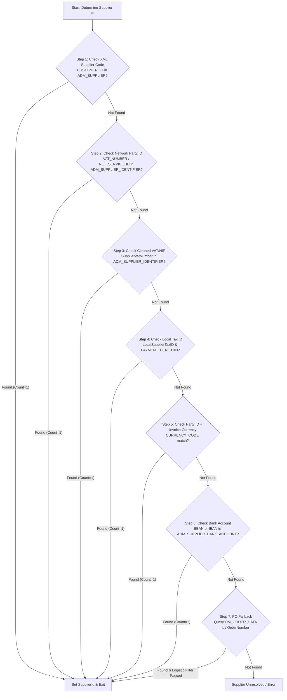
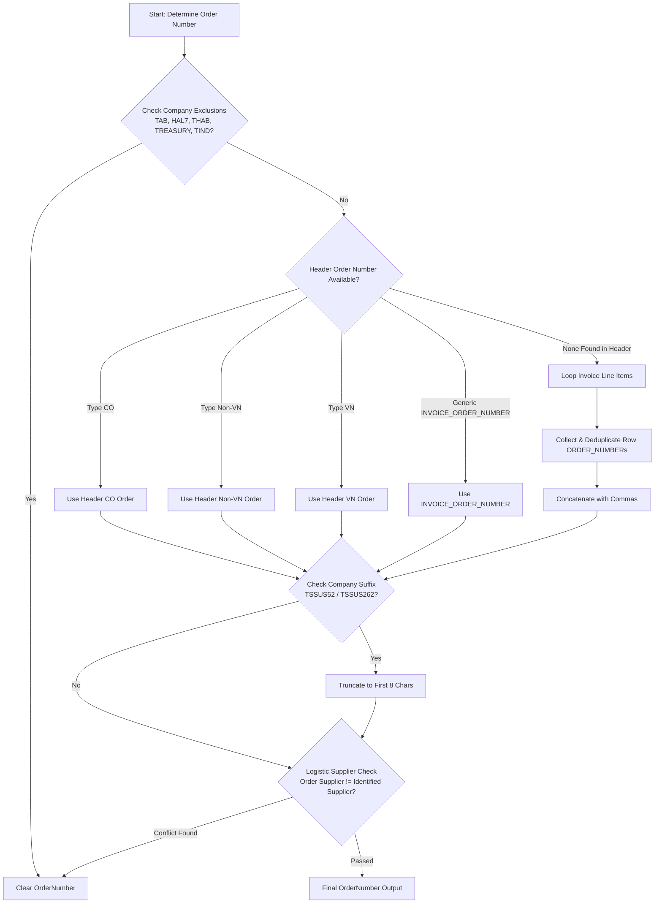
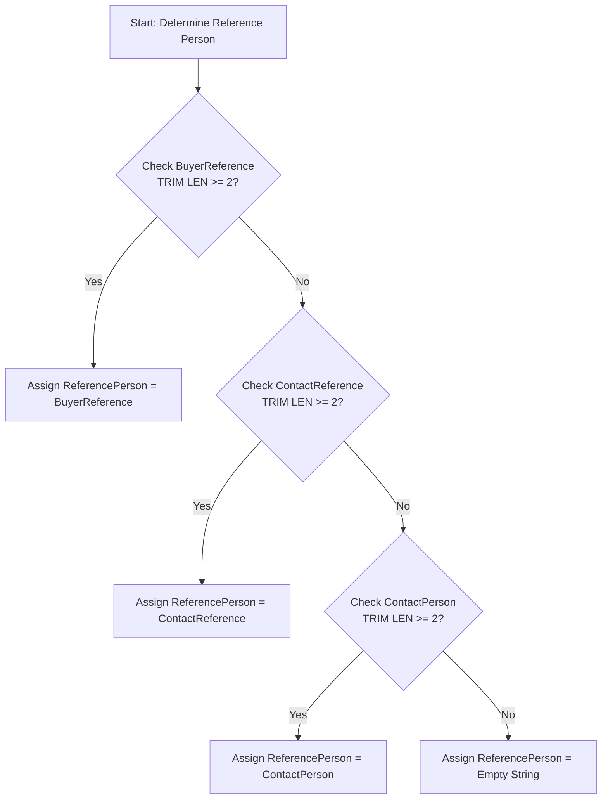
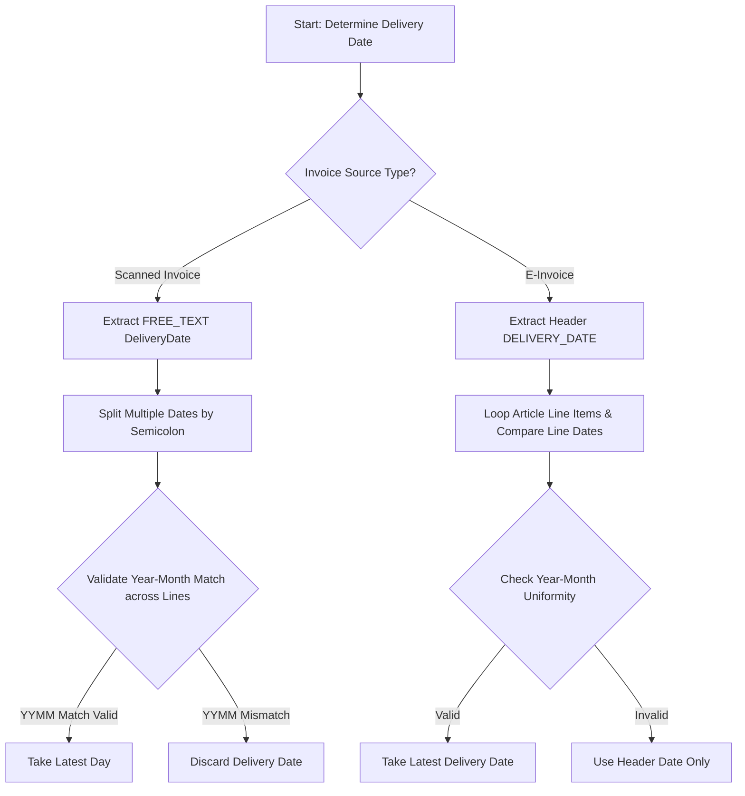
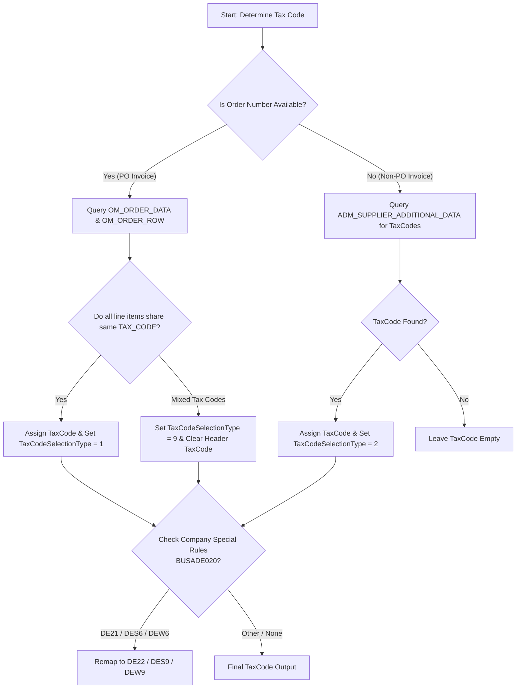

# Basware ERP Connector Field Mapping & Logic Specification

This technical document details the field extraction, decision trees, and determination rules for the **NewInvoice** integration process.

## 1. Executive Summary & Processing Architecture

The integration engine processes incoming invoice XML files through four primary operational categories:

- **Direct XML Mapping**: Direct 1:1 extraction from XML nodes.

- **Cascading Fallback**: Sequential evaluation across multiple potential sources until a match is confirmed.

- **DB Lookup & Rules**: Dynamic SQL queries against ERP master tables (`ADM_SUPPLIER`, `OM_ORDER_DATA`, `EXT_INV_LIST_17`).

- **System Metadata**: Injection of runtime metadata (filenames, scan IDs, skip flags).

## 2. Visual Business Logic Decision Trees (Flowcharts)

### 2.1. Supplier ID Determination Cascade (7-Step Priority)

### 2.2. Order Number Extraction & Filtering Flow

### 2.3. Reference Person Selection Priority

### 2.4. Delivery Date Processing Logic

### 2.5. Tax Code Determination & PO Matching

## 3. Comprehensive Field Mapping Matrix

| # | Basware Field Name | Technical Parameter | Logic Category | Value Mapping Expression | Condition / Business Rule | Description & Behavior |
|---|---|---|---|---|---|---|
| 1 | **Base Line Date** | `BaseDate` | Business Rule / Conditional | `{v,InvoiceDate}` | `{v,isInvoiceDate}` | Mapped from invoice variable / XML source according to standard ERP connector rules. |
| 2 | **Cash Date** | `CashDate` | Business Rule / Conditional | *Empty* | None | Mapped from invoice variable / XML source according to standard ERP connector rules. |
| 3 | **Currency Code** | `CurrencyCode` | Direct XML Mapping | `{v,CurrencyCode}` | None | Mapped from invoice variable / XML source according to standard ERP connector rules. |
| 4 | **CurrencyCodeComp** | `CurrencyCodeCompany` | Direct XML Mapping | `{v,CurrencyCode}` | None | Mapped from invoice variable / XML source according to standard ERP connector rules. |
| 5 | **CurrencyCodeOrg** | `CurrencyCodeOrganization` | Direct XML Mapping | `{v,CurrencyCode}` | None | Mapped from invoice variable / XML source according to standard ERP connector rules. |
| 6 | **Exchange Rate TB** | `Num10` | Direct XML Mapping | `{v,ExchangeRate}` | None | Mapped from invoice variable / XML source according to standard ERP connector rules. |
| 7 | **Scan Date** | `Date2` | Direct XML Mapping | `{v,Date2}` | None | Mapped from invoice variable / XML source according to standard ERP connector rules. |
| 8 | **Gross Total** | `GrossSum` | Direct XML Mapping | `{v,HeaderSumGross}` | None | Mapped from invoice variable / XML source according to standard ERP connector rules. |
| 9 | **Net Total** | `NetSum` | Direct XML Mapping | `{v,HeaderSumNet}` | None | Mapped from invoice variable / XML source according to standard ERP connector rules. |
| 10 | **Tax Sum** | `TaxSum` | Direct XML Mapping | `{v,HeaderTaxSum}` | None | Mapped from invoice variable / XML source according to standard ERP connector rules. |
| 11 | **Tax Sum TB** | `Num11` | Direct XML Mapping | `{v,HeaderTaxSum}` | None | Mapped from invoice variable / XML source according to standard ERP connector rules. |
| 12 | **Tax Sum2** | `Num23` | Business Rule / Conditional | `{v,HeaderTaxSum2}` | `{F,INSTR(v,CompanyEntityValidations;&quot;V_051&quot;;TRUE;FALSE)}` | Mapped from invoice variable / XML source according to standard ERP connector rules. |
| 13 | **Invoice Date** | `InvoiceDate` | Business Rule / Conditional | `{v,InvoiceDate}` | `{v,isInvoiceDate}` | Mapped from invoice variable / XML source according to standard ERP connector rules. |
| 14 | **Invoice Number** | `InvoiceNumber` | Direct XML Mapping | `{v,InvoiceNumber}` | None | Mapped from invoice variable / XML source according to standard ERP connector rules. |
| 15 | **Invoice Type Code** | `InvoiceTypeCode` | Direct XML Mapping | `{v,InvoiceType}` | None | Mapped from invoice variable / XML source according to standard ERP connector rules. |
| 16 | **Order Number** | `OrderNumber` | Cascading Fallback | `{v,OrderNumber}` | None | Extracted from XML header (CO -> Non-VN -> VN -> INVOICE_ORDER_NUMBER) or concatenated from line items. Filtered for specific company codes and logistic suppliers. |
| 17 | **Reference Person** | `ReferencePerson` | Cascading Fallback | `{v,BuyerReference}` | None | Selected via priority chain: BuyerReference -> ContactReference -> ContactPerson -> Empty (min length >= 2 chars). |
| 18 | **Reference Person** | `ReferencePerson` | Cascading Fallback | `{v,ContactReference}` | None | Selected via priority chain: BuyerReference -> ContactReference -> ContactPerson -> Empty (min length >= 2 chars). |
| 19 | **Reference Person** | `ReferencePerson` | Cascading Fallback | `{v,ContactPerson}` | None | Selected via priority chain: BuyerReference -> ContactReference -> ContactPerson -> Empty (min length >= 2 chars). |
| 20 | **Reference Person** | `ReferencePerson` | Cascading Fallback | *Empty* | None | Selected via priority chain: BuyerReference -> ContactReference -> ContactPerson -> Empty (min length >= 2 chars). |
| 21 | **Origin** | `Origin` | Direct XML Mapping | `{v,Origin}` | None | Mapped from invoice variable / XML source according to standard ERP connector rules. |
| 22 | **ContractNumber** | `ContractNumber` | Direct XML Mapping | `{v,ContractNumber}` | None | Mapped from invoice variable / XML source according to standard ERP connector rules. |
| 23 | **Reference Number** | `ReferenceNumber` | Direct XML Mapping | `{v,ReferenceNumber}` | None | Mapped from invoice variable / XML source according to standard ERP connector rules. |
| 24 | **AP Status** | `Text11` | DB Lookup & Rules | `{F,DBSELECT("SELECT TEXT_3 FROM EXT_INV_LIST_17
									WHERE TEXT_1='SupplierAPStatus' AND ADMINISTRATIVE_SITE_ID=? AND TEXT_2=?";v,providerconnection;v,CompanyId;v,SupplierCode)}` | `{F,INSTR(v,CompanyEntityConfigurations;&quot;C_109&quot;;TRUE;FALSE)}` | Pulls supplier AP status from EXT_INV_LIST_17 table if C_109 configuration is enabled for the company. |
| 25 | **Scan Service Id** | `Text19` | Direct XML Mapping | `{v,ScanServiceId_BLOCK_ID}` | None | Mapped from invoice variable / XML source according to standard ERP connector rules. |
| 26 | **TaxCode** | `TaxCode` | Direct XML Mapping | `{v,HeaderTaxCode}` | None | Matched against Purchase Order rows in ERP (OM_ORDER_DATA). Falls back to Supplier Master default (TaxCodes). Special handling for BUSADE020. |
| 27 | **TaxPercent** | `TaxPercent` | Direct XML Mapping | `{v,HeaderTaxPercentage}` | None | Mapped from invoice variable / XML source according to standard ERP connector rules. |
| 28 | **Item Tax Code** | `Text21` | Direct XML Mapping | `{v,HeaderItemTaxCode}` | None | Mapped from invoice variable / XML source according to standard ERP connector rules. |
| 29 | **Payment Plan Reference** | `PaymentPlanReference` | Direct XML Mapping | `{v,PaymentPlanReference}` | None | Mapped from invoice variable / XML source according to standard ERP connector rules. |
| 30 | **Delivery Date** | `Date3` | Cascading Fallback | `{v,DeliveryDate}` | `{v,isInvoiceDeliveryDate}` | For Scanned invoices: extracted from free text, validated by YYMM match across lines. For E-Invoices: header date compared with line item delivery dates. |
| 31 | **Invoice Due Date** | `Date4` | Business Rule / Conditional | `{v,DueDate}` | `{v,isDueDate}` | Pulls due date from XML. Defaults to current system date if omitted. |
| 32 | **Supplier Vat Number** | `Text23` | Direct XML Mapping | `{v,SupplierVatNumber}` | None | Mapped from invoice variable / XML source according to standard ERP connector rules. |
| 33 | **Supplier Local Tax ID** | `Text25` | Direct XML Mapping | `{v,LocalSupplierTaxID}` | None | Mapped from invoice variable / XML source according to standard ERP connector rules. |
| 34 | **Trelleborg VAT Number** | `Text26` | Direct XML Mapping | `{v,TrelleborgVatNumber}` | None | Mapped from invoice variable / XML source according to standard ERP connector rules. |
| 35 | **Keywords** | `Text27` | Direct XML Mapping | `{v,KeyWords}` | None | Mapped from invoice variable / XML source according to standard ERP connector rules. |
| 36 | **Company Name on Invoice** | `Text28` | Direct XML Mapping | `{v,CompNameFromInvoice}` | None | Mapped from invoice variable / XML source according to standard ERP connector rules. |
| 37 | **Delivery Address** | `Num7` | Direct XML Mapping | `{v,DeliveryAddress}` | None | Mapped from invoice variable / XML source according to standard ERP connector rules. |
| 38 | **Tax Code selection type** | `Num8` | Direct XML Mapping | `{v,TaxCodeSelectionType}` | None | Mapped from invoice variable / XML source according to standard ERP connector rules. |
| 39 | **Auto Send to Process** | `Num2` | Direct XML Mapping | `{v,Num2}` | None | Determined by checking AUTOSENDTOPROCESSSUPPLIER entries in EXT_INV_LIST_17 by company, supplier, and invoice type. Returns 2 (auto-send) or 1 (manual). |
| 40 | **Num22** | `Num22` | Direct XML Mapping | `{v,SupplierInvoiceWarning}` | None | Mapped from invoice variable / XML source according to standard ERP connector rules. |
| 41 | **Supplier BBAN** | `SupplierBankAccountBBAN` | Direct XML Mapping | `{v,SupplierBBAN}` | None | Mapped from invoice variable / XML source according to standard ERP connector rules. |
| 42 | **Supplier IBAN** | `SupplierBankAccountIBAN` | Direct XML Mapping | `{v,SupplierIBAN}` | None | Mapped from invoice variable / XML source according to standard ERP connector rules. |
| 43 | **Division** | `Text8` | Direct XML Mapping | `{v,Division}` | None | Mapped from invoice variable / XML source according to standard ERP connector rules. |
| 44 | **Additional Data 1** | `Text6` | Direct XML Mapping | `{v,AdditionalData1}` | None | Populated from company division and entity-specific additional data configuration. |
| 45 | **Supplier Type** | `Text14` | Direct XML Mapping | `{v,VendorType}` | None | Mapped from invoice variable / XML source according to standard ERP connector rules. |
| 46 | **Text59** | `Text59` | Direct XML Mapping | `{v,TCode}` | None | Mapped from invoice variable / XML source according to standard ERP connector rules. |
| 47 | **UWAGA: Text15 w Basware = Tax Code 2** | `Text15` | Direct XML Mapping | `{v,file_name}` | None | Mapped from invoice variable / XML source according to standard ERP connector rules. |
| 48 | **Email from Sender** | `Text30` | Direct XML Mapping | `{v,EmailFromSender}` | None | Mapped from invoice variable / XML source according to standard ERP connector rules. |
| 49 | **VAT Serial Number** | `Text34` | Direct XML Mapping | `{v,VATSerialNumber}` | None | Mapped from invoice variable / XML source according to standard ERP connector rules. |
| 50 | **VAT Format Number** | `Text35` | Direct XML Mapping | `{v,VATFormatNumber}` | None | Mapped from invoice variable / XML source according to standard ERP connector rules. |
| 51 | **Text51** | `Text51` | Direct XML Mapping | `{v,skiprule}` | None | Mapped from invoice variable / XML source according to standard ERP connector rules. |
| 52 | **Text37** | `Text37` | Direct XML Mapping | `{v,ScannedIBAN}` | None | Mapped from invoice variable / XML source according to standard ERP connector rules. |
| 53 | **Text38** | `Text38` | Direct XML Mapping | `{v,ScannedBBAN}` | None | Mapped from invoice variable / XML source according to standard ERP connector rules. |